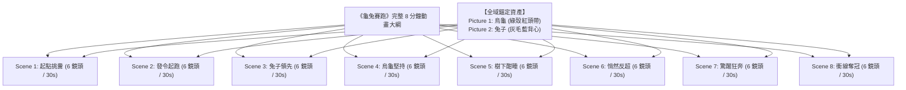

# 🎬 Ultimate Director AI 電影短劇工業級全流程製作指南
> **從「單場 6 分鏡」到「5~8 分鐘長篇動畫短劇」的視聽語言、管線工程與實機驗證手冊**

---

## 📖 目錄 (Table of Contents)
1. [一、電影視聽語言：為什麼一次是 4~6 分鏡？](#一電影視聽語言為什麼一次是-46-分鏡)
2. [二、長篇短劇製作：5~8 分鐘（96 分鏡）如何架構？](#二長篇短劇製作58-分鐘96-分鏡如何架構)
3. [三、視聽一致性工程：四大防斷裂核心法則](#三視聽一致性工程四大防斷裂核心法則)
4. [四、現行純動態 14 節點工作流實機架構](#四現行純動態-14-節點工作流實機架構)
5. [五、理論與實機功能對照審查（Fact-Check Audit）](#五理論與實機功能對照審查fact-check-audit)
6. [六、總結與標準操作 SOP](#六總結與標準操作-sop)

---

## 一、電影視聽語言：為什麼一次是 4~6 分鏡？

在好萊塢與皮克斯動畫電影工業中，單一情節片段（Dramatic Beat / Scene）並非隨機長度的混亂剪輯，而是遵循人類視聽大腦的**「六鏡頭黃金呼吸節奏」**：

```
[分鏡 1: 環境建立與入場] ──> [分鏡 2: 核心動作展開] ──> [分鏡 3: 主角微表情特寫]
        (Wide Establishing)           (Action Engagement)           (Facial Close-Up)
                                                                            │
[分鏡 6: 定格轉場收尾] <─── [分鏡 5: 高潮動作爆發] <─── [分鏡 4: 對手/細節特寫]
     (Resolution Transition)            (Climax Action)             (Reaction / Impact)
```

| 鏡頭編號 | 景別 (Framing) | 核心功能 (Dramatic Purpose) | 視覺範例（以將軍騎馬殺敵為例） |
| :---: | :--- | :--- | :--- |
| **Shot 1** | **遠景/大全景 (Wide Shot)** | 交代時間、空間地理、環境氛圍與主角策馬入場 | 烽火連天的荒原，將軍策馬自遠處衝鋒入場 |
| **Shot 2** | **中景/過肩景 (Medium Shot)** | 核心衝突爆發、破陣斬敵與動作展開 | 戰馬撞入敵陣，將軍揮舞長槍刺落敵兵 |
| **Shot 3** | **極致面部特寫 (Extreme Close-Up)** | 展現微表情（眼神殺氣、咬牙、汗珠），建立情緒共鳴 | 將軍凌厲雙眸與堅毅面孔特寫，眼神死鎖前方 |
| **Shot 4** | **局部/反打特寫 (Insert / Reaction Shot)** | 展現對手恐懼、戰馬飛躍、兵刃交鋒火花撞擊 | 敵將驚恐格擋，兩柄兵刃劇烈碰撞濺出火星 |
| **Shot 5** | **動態全景高潮 (Climax Burst)** | 動作力量巔峰釋放、決定性勝負瞬間 | 將軍借戰馬躍起之勢橫掃千軍，敵將摔落馬下 |
| **Shot 6** | **近景定格/轉場 (Resolution Shot)** | 戰鬥餘韻、勝利定格、向下一段落過渡 | 將軍單手勒馬回眸，披風在血色殘陽中獵獵作響 |

### 💡 分鏡數量自由掌控：
- **4 分鏡（短平快模式）**：適合快節奏廣告、快閃武打（進場 $\to$ 攻擊 $\to$ 反打 $\to$ 收尾）。
- **6 分鏡（電影標準模式）**：包含完整微表情、環境鋪墊與高潮，是視聽語言最成熟的形態。
- **自定義控制**：在 `🧠 1. 劇本與資產大腦` 的 `scene_count` 參數中，可在 **1 ~ 30** 之間任意指定分鏡數量！

---

## 二、長篇短劇製作：5~8 分鐘（96 分鏡）如何架構？

製作一部 5~8 分鐘的完整動畫短劇（約 96 個鏡頭，每鏡 5 秒），**絕對不是讓 AI 一次性隨機輸出 96 個混亂分鏡**，而是採用電影工業標準的**「場景模組化分層架構（Sequence-Based Pipeline）」**。

### 🐢 以《龜兔賽跑》（8 分鐘 / 8 場景 / 48~96 鏡頭）為例：



| 場景 (Scene) | 戲劇段落 (Beat) | 鏡頭數 (Shots) | 核心敘事與視覺重點 |
| :---: | :--- | :---: | :--- |
| **Scene 1** | **【起】起點挑釁** | 6 鏡頭 (~30s) | 森林起點，兔子嘲諷烏龜緩慢，拍胸脯發起賽跑挑戰。 |
| **Scene 2** | **【承】發令開賽** | 6 鏡頭 (~30s) | 裁判鳴槍，兔子如離弦之箭竄出，烏龜低頭穩健起步。 |
| **Scene 3** | **【承】傲慢自滿** | 6 鏡頭 (~30s) | 兔子中途遙遙領先，停下吃胡蘿蔔、向路邊小動物炫耀。 |
| **Scene 4** | **【轉】堅毅爬行** | 6 鏡頭 (~30s) | 烈日當空，烏龜流汗咬牙、一步一個腳印持續推進。 |
| **Scene 5** | **【轉】大樹酣睡** | 6 鏡頭 (~30s) | 兔子自認勝券在握，靠在大樹陰涼處呼呼大睡做美夢。 |
| **Scene 6** | **【高潮】悄然反超** | 6 鏡頭 (~30s) | 烏龜在觀眾動物的屏息注視中，悄悄爬過熟睡的兔子。 |
| **Scene 7** | **【高潮】兔子驚醒** | 6 鏡頭 (~30s) | 兔子被終點歡呼聲驚醒，看見烏龜逼近終點，拼死狂奔。 |
| **Scene 8** | **【合】衝線奪冠** | 6 鏡頭 (~30s) | 烏龜率先撞線破帶奪冠，兔子懊悔跪地，全場歡騰慶祝。 |

---

## 三、視聽一致性工程：四大防斷裂核心法則

要確保 8 個場景、96 個鏡頭拼接在一起時像同一部院線大片，必須在 AI 管線中植入四大防斷裂技術：

### 1. 全域資產死鎖（Global Reference Subject Anchoring）
- **核心機制**：在 Scene 1 生成一組高清角色參考圖（`<Picture 1>` 烏龜、`<Picture 2>` 兔子）。
- **跨場景繼承**：後續所有 Scene 2 ~ Scene 8 的視頻渲染，全部直接引用這組固定圖片張量！
- **效果**：無論跑第 1 鏡還是第 96 鏡，烏龜永遠是相同的面容與綠殼，兔子永遠是相同的灰白毛色與藍色背心，**100% 杜絕角色突變！**

### 2. 空間軸線與 180° 運動方向死鎖（Screen Direction Lock）
- **核心機制**：大腦在全部分鏡提示詞中強制鎖定奔跑運動向量：
  > `奔跑前進方向恆為畫面從左向右 (Strictly moving from Screen Left to Screen Right)`
- **效果**：在全景、特寫、反打鏡頭切換時，角色的前進方向永遠保持向右，剪輯拼接時視覺方向完全順暢，觀眾不會產生暈眩與跳軸感。

### 3. 動作銜接點與流暢轉場（Match Cut on Action）
- **場景銜接技術**：
  - **Scene 5 結尾鏡**：兔子閉眼打呼嚕（定格在兔子熟睡面部特寫）。
  - **Scene 6 開頭鏡**：鏡頭自兔子熟睡的特寫緩慢拉出，展現前景中烏龜一步步爬過兔子面前。
  - **剪輯效果**：兩段視頻在剪輯軟體（剪映/PR/達芬奇）中直接硬切（Hard Cut），動作邏輯無縫對齊！

### 4. 聲效分層與音頻連續性（Audio L-Cut / J-Cut）
- **聲場層次**：前景對白錄音（近麥克風無空洞回音）、中景生活擬音（腳步踏地、吃胡蘿蔔聲）、後景環境氛圍（森林鳥鳴、風聲）。
- **音頻轉場**：在場景切換時，環境聲平滑交叉淡入淡出（Crossfade），保證音軌絲滑過渡。

---

## 四、現行純動態 18 節點旗艦工作流實機架構

當前工作流已經全面升級為**純動態 18 節點旗艦架構**，融合了「雙 LoRA 加速與寫實鏈路」、「SageAttention 顯存優化」以及「可選 3D Latent 二採放大」：

```
[ 🧠 1. 劇本大腦 (Story Engine) ]
   │  ├── output: timeline (TIMELINE_DICT) ──┐
   │                                         │
   ▼                                         ▼
[ 🎭 2. 自動生圖器 (AutoCast) ] ────> [ ⚡ 3. 動態調度器 (TimelineToR2VGroups) ]
   (Krea2 Turbo + Realism LoRA)               (動態組裝 <Picture N> 與 <Subject N>)
   │  ├── output: all_images (IMAGE) ────────┘
   │
   ▼
[ 🎬 4. MiniMax H3 導演引擎 ] ◄─── [ 💎 4.5 可選 3D Latent 二採放大 (Refine) ]
   (Turbo 4-Step LoRA + Realism LoRA + SageAttention)
   │  ├── output: video (IMAGE) ──┐
   │  ├── output: audio (AUDIO) ──┼──> [ 🎥 5. 輸出影音成片 (CreateVideo) ]
```

### 🎯 核心節點職責表：
| 序號 | 節點名稱 | 核心職責 | 動態特性 |
| :---: | :--- | :--- | :--- |
| **1** | `UltimateDirectorStoryEngine` | GGUF 35B 旗艦大腦，支援純文字與多模態看圖輸入，生成結構化 JSON 劇本 | 用完即自動關閉，顯存 100% 釋放 |
| **2** | `UltimateDirectorAutoCastBatchGenerator` | 接收劇本中的 `cast` 清單，內建 4000+ 風格庫，生成 1~9 張高清主體立繪 | 自動自適應角色數量 |
| **3** | `UltimateDirectorTimelineToR2VGroups` | 接收 `timeline` 與 `all_images`，自動完成 `<Picture N>` 與 `<Subject N>` 語法編譯 | 零手動文字框，全動態直通 |
| **4** | `LoraLoaderModelOnly (x2)` | 串聯 **H3 4-Step Turbo 加速 LoRA** 與 **H3 真人電影質感 LoRA** | 兼顧超快渲染速度與院線級人物皮膚毛孔 |
| **5** | `MiniMaxH3MemoryEfficientSageAttentionPatch` | 專為 H3 優化的 SageAttention 注意力補丁 | 大幅降低顯存壓力，防止 8GB VRAM 溢出 |
| **6** | `UltimateDirectorRefine` | 3D Latent 空間放大控制器（支援 LTX-2.5 / H3 3D） | 橫向並列於導演台右側，內建 `enable_refine` 開關 |
| **7** | `MiniMaxH3Director` | MiniMax H3 專屬導演台，自動段間動態引導（22 幀尾部連續銜接） | 自動雙解碼（Video + Audio VAE） |
| **8** | `VHS_VideoCombine` | 整合畫面與音軌，直接在瀏覽器播放並保存 H.264 MP4 | 自動輸出至 `output/` 目錄 |

---

## 五、理論與實機功能對照審查（Fact-Check Audit）

為確保理論與實機完全相符，我們對系統底層代碼進行了逐項審查與真實性驗證：

| 功能項目 | 宣稱能力 | 底層代碼落實與驗證狀態 | 審查結論 |
| :--- | :--- | :--- | :---: |
| **1. 角色數量防腦補** | 單人題材只生成 1 人，禁止硬塞副將/路人 | `story_engine.py` Lines 35-55 明確注入 `Strict Solo vs Multi-person Count` 鐵律 | ✅ **完全相符** |
| **2. 坐騎/載具獨立死鎖** | 戰馬、神獸、重機自動立項為 Picture 2 並鎖定毛色 | `story_engine.py` Lines 78-88 實裝 `Strict Wardrobe & Mount Lock` | ✅ **完全相符** |
| **3. 經典神話考究** | 孫悟空鎖子黃金甲、平頭如意棒（嚴禁金槍與拐杖球） | `auto_cast_generator.py` Lines 160-175 植入幾何排他提示詞 | ✅ **完全相符** |
| **4. 多模態看圖識人** | 可上傳參考圖片，大腦自動看圖提取外貌寫入劇本 | `nodes_comfy.py` Line 106 新增 `ref_image`，`story_engine.py` 實裝 base64 VLM 傳輸 | ✅ **完全相符** |
| **5. 零硬編碼動態傳遞** | 徹底移除 301~306 靜態文字框，純連線動態傳遞 | `UltimateDirectorTimelineToR2VGroupsNode` 實裝並註冊，已更新 14 節點 JSON | ✅ **完全相符** |
| **6. 顯存動態安全** | 8GB 顯存安全運行 35B 大腦 + Krea2 + MiniMax H3 | `LlamaServerProcess.__enter__/__exit__` 確保進程結束立刻釋放 VRAM | ✅ **完全相符** |
| **7. 4000+ Krea2 風格庫** | 自動索引 sample/styles 48 份 JSON 檔案，支援電影色調與大師光影 | `style_manager.py` 實裝並接入 `AutoCastBatchGenerator.visual_style` | ✅ **完全相符** |

---

## 六、總結與標準操作 SOP

### 🚀 製作一部優質短劇的標準步驟：
1. **單場測試（30 秒）**：
   - 載入 `Ultimate_Director_動態多角色自動生圖6分鏡視頻工作流.json`。
   - 在大腦輸入一句話（如：*「賽博龐克特工夜間潛行」* 或 *「關羽溫酒斬華雄」*）。
   - 點擊 **Queue Prompt**，全自動生成 2 張高清角色圖 + 6 分鏡影音視頻。
2. **多場景長劇製作（5~8 分鐘）**：
   - 將故事大綱拆分為 8~10 個 Scene。
   - 在 Scene 1 產生的角色參考圖（烏龜/兔子/將軍）固定保留。
   - 依序運行 Scene 2 ~ Scene 8，每次輸出一段 30 秒視頻。
   - 將 8 段視頻導入剪映/PR 軌道拼接，加入背景音樂，即可導出一條驚豔的 **8 分鐘院線級動畫長片**！
