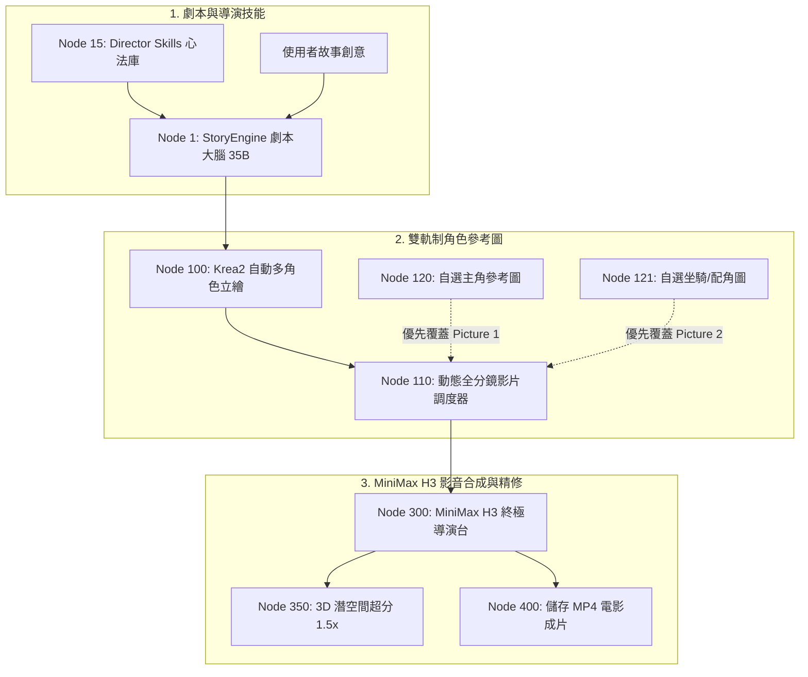

# 🎬 ComfyUI Ultimate Director (終極導演系統) 完整操作與技術手冊

本手冊為 **ComfyUI 終極導演系統（Ultimate Director & MiniMax H3 Pipeline）** 的權威操作與技術手冊。
系統專為 **個人工作站（8GB ~ 24GB VRAM）** 量身定製，涵蓋從 **「一句創意 ➡️ 本地 35B 劇本大腦 ➡️ 動態多角色立繪/自選置換 ➡️ MiniMax H3 全自動 6 分鏡影音合成 ➡️ 3D 潛空間超分二採放大」** 的全流程架構與參數秘笈！

---

## 📑 目錄
1. [工作流架構總覽](#1-工作流架構總覽)
2. [第 0 步：導演技能心法庫 (Director Skills Ingestion)](#2-第-0-步導演技能心法庫-director-skills-ingestion)
3. [第 1 步：劇本創作大腦 (Story Engine GGUF 35B)](#3-第-1-步劇本創作大腦-story-engine-gguf-35b)
4. [第 2 步：動態多角色生圖與自訂參考圖置換 (Auto Cast & Custom Override)](#4-第-2-步動態多角色生圖與自訂參考圖置換-auto-cast--custom-override)
5. [第 3 步：MiniMax H3 LoRA 權重選型全指南（核心秘笈）](#5-第-3-步minimax-h3-lora-權重選型全指南核心秘笈)
6. [第 4 步：取樣器、排程器與 Shift 參數黃金調校表](#6-第-4-步取樣器排程器與-shift-參數黃金調校表)
7. [第 5 步：MiniMax H3 官方專有 `DY.subject_definitions` 提示詞格式解析](#7-第-5-步minimax-h3-官方專有-dysubject_definitions-提示詞格式解析)
8. [第 6 步：3D 潛空間超分放大與二次精修 (Refine Controller)](#8-第-6-步3d-潛空間超分放大與二次精修-refine-controller)
9. [常見問題與避坑指南 (FAQ & Troubleshooting)](#9-常見問題與避坑指南-faq--troubleshooting)

---

## 1. 工作流架構總覽

在 ComfyUI 中直接載入桌面工作流檔案：
👉 `~/Desktop/Ultimate_Director_動態多角色自動生圖6分鏡視頻工作流.json`
（或 `user/default/workflows/Ultimate_Director_動態多角色自動生圖6分鏡視頻工作流.json`）

### 🌟 三大核心流程模組：


---

## 2. 第 0 步：導演技能心法庫 (Director Skills Ingestion)

### 節點：`🧠 0. 導演提示詞技能心法庫 (Node 15 - PrimitiveNode)`
* **位置**：左上角第一區塊，直連 Node 1 `custom_skill_prompt`。
* **功能**：允許使用者以 Markdown 格式注入客製化的專業導演技能規則。
* **預設內建四大心法**：
  1. **角色立繪標準 (Krea2 Asset)**：要求 35mm 真人電影質感、自然皮膚毛孔、無文字無浮水印。
  2. **坐騎與載具外觀死鎖 (Mount Lock)**：鎖定坐騎毛色（如純黑汗血戰馬、暗紅真皮馬鞍），所有分鏡 100% 一致。
  3. **景別律動與微表情 (Cinematic Progression)**：要求 6 分鏡景別由遠及近（全景 ➡️ 衝鋒 ➡️ 微表情特寫 ➡️ 兵刃交鋒 ➡️ 高潮 ➡️ 定格）。
  4. **聲場音效設計 (Soundscape)**：規範近麥人聲、踏地聲、金屬撞擊與遠處雷鳴層次。

---

## 3. 第 1 步：劇本創作大腦 (Story Engine GGUF 35B)

### 節點：`🧠 1. 劇本與資產大腦 (Node 1 - UltimateDirectorStoryEngine)`
* **大模型載入**：預設指向本地 `/media/sam/data/ComfyUI/models/LLM/Ornith-1.5-35B-Q4_K_M.gguf`。
* **0MB 顯存釋放機制**：後台自動啟動 `llama-server` 子行程，推理完成後立即關閉進程，**100% 釋放全部 CUDA 顯存給後續生圖與視頻模型**。
* **多模態看圖輸入 (`ref_image`)**：若連接圖片，VLM 會自動看圖提取長相、穿著與特徵並寫入劇本設定中。

---

## 4. 第 2 步：動態多角色生圖與自定義參考圖置換 (Auto Cast & Custom Override)

### 雙軌制架構設計：
1. **軌道 A（全自動生圖）**：
   * **Node 100 (`AutoCastBatchGenerator`)**：根據劇本 `cast` 名單，自適應生成 1~9 個角色的全身獨立立繪（由 Krea2 Turbo + Realism LoRA 生成）。
   * **Node 105 (`PreviewImage`)**：橫向拼接預覽所有生成的主角與坐騎立繪。
2. **軌道 B（自選參考圖置換 - 推薦！）**：
   * **Node 120 (`LoadImage - 自選參考圖 1: 主角`)**
   * **Node 121 (`LoadImage - 自選參考圖 2: 坐騎/配角`)**
   * **運作機制**：若你在 Node 120/121 中上傳或拖入滿意的主角將軍或坐騎照片，**調度器（Node 110）會 100% 優先採用你的真實參考圖覆蓋 Picture 1 / Picture 2**！未連線時則無縫回退至 Krea2 自動生成圖。

---

## 5. 第 3 步：MiniMax H3 LoRA 權重選型全指南（核心秘籍）

MiniMax H3 社群有眾多 LoRA，請務必按照下表選用：

| LoRA 模型名稱 | 適用場景 | 推薦步數 | 顯存/質感特點 | 推薦度 |
| :--- | :--- | :--- | :--- | :--- |
| **`minimax_h3_fl2v_turbo_8step_v1.0_768p_comfyui_bf16.safetensors`** | **旗艦電影出片（首選）** | **8 ~ 12 步** | 768p 原生高清數據集訓練，人臉五官精緻，完全消除假人感，音畫高度同步 | ⭐⭐⭐⭐⭐ **必備首選** |
| `minimax_h3_ref2v_turbo_4step_v0.1_comfyui_bf16.safetensors` | 快速分鏡/動作測試 | 4 步 | 極速出片，但時間步過短易產生手辦塑膠感，不可疊加寫實 LoRA | ⭐⭐⭐ 適合草稿驗證 |
| `h3-realism-people-t2v-i2v-r2v.safetensors` | 真人皮膚與電影寫實增強 | 配合 8~12 步 | 強度設為 `0.7`（需配合 8 步 Turbo 使用；4 步 Turbo 下請設 `0.0`） | ⭐⭐⭐⭐⭐ 推薦疊加 |
| `alibaba-pai/MiniMax-H3-Acc-LoRAs` / `aptech0081` | 阿里 PAI PDD 實驗版 | 8 步 | 需額外安裝專用 PDD Head 節點插件，原生 LoRA 節點不可直接載入 | ⭐⭐ 暫不推薦 |
| `Momoking / lightx2v MiniMax-H3-Prompt-Rewriter-LoRA` | LLM 提示詞改寫 | N/A | 本地已擁有 35B 劇本大腦 + 內建 DY 語法，**完全不需要下載** | ❌ 無需下載 |

> 📥 **8 步旗艦 LoRA 直鏈下載**：
> [minimax_h3_fl2v_turbo_8step_v1.0_768p_comfyui_bf16.safetensors](https://huggingface.co/lightx2v/Minimax-h3-Turbo/resolve/main/minimax_h3_fl2v_turbo_8step_v1.0_768p_comfyui_bf16.safetensors?download=true)
> 存放目錄：`/media/sam/data/ComfyUI/models/loras/`

---

## 6. 第 4 步：取樣器、排程器與 Shift 參數黃金調校表

在 **Node 300 (`MiniMaxH3Director`)** 中，根據出片需求切換以下兩套黃金參數：

### 🎬 模式 A：作者同款 12 步電影質感旗艦模式（正式出片推薦）
* **LoRA 24 (Turbo LoRA)**：`minimax_h3_fl2v_turbo_8step_v1.0_768p_comfyui_bf16`（強度 `1.0`）
* **LoRA 25 (Realism LoRA)**：`h3-realism-people-t2v-i2v-r2v`（強度 **`0.7`**）
* **Node 300 參數設置**：
  * `steps`: **`12`**（或 10）
  * `sampler_name`: **`euler`**
  * `scheduler`: **`beta`**（或 `simple`）
  * `shift_video`: **`6.0`**（8步專用平滑值）
  * `shift_audio`: **`3.0`**
  * `cfg`: `1.0`

### ⚡ 模式 B：4 步極速預覽模式（快速驗證分鏡與構圖）
* **LoRA 24 (Turbo LoRA)**：`minimax_h3_ref2v_turbo_4step_v0.1_comfyui_bf16`（強度 `1.0`）
* **LoRA 25 (Realism LoRA)**：設為 **`0.0`**（4 步下不可疊加寫實 LoRA）
* **Node 300 參數設置**：
  * `steps`: **`4`**
  * `sampler_name`: **`res_multistep`**
  * `scheduler`: **`simple`**
  * `shift_video`: **`12.0`**
  * `shift_audio`: **`3.0`**

---

## 7. 第 5 步：MiniMax H3 官方專有 `DY.subject_definitions` 提示詞格式解析

### 💡 為什麼之前上一輪「馬匹會變成全景半透明背景」？
MiniMax H3 的文本編碼器為 **Qwen3-VL 32B**。在多參考圖（R2V）任務中，若提示詞僅是簡單拼接，Qwen3-VL 會把 `<Picture 2>` 誤判為整張畫布的背景貼圖。

### 📐 調度器（Node 110）自動生成的標準結構化語法：
```text
DY.subject_definitions:
<Subject 1> is the 將軍 whose visual identity comes from <Picture 1>, preserving 英姿颯爽冷峻五官，身披暗銀鱗甲與紅色戰袍，手持玄鐵長槍。
<Subject 2> is the 純黑戰馬 whose visual identity comes from <Picture 2>, preserving 通體烏黑油亮高大汗血戰馬，肌肉健碩，配備深紅色真皮馬鞍。

summary:
[reference generation] 0-5.5s, <Subject 1> 將軍 騎乘在 <Subject 2> 純黑戰馬 之上，在烽火戰場中策馬衝鋒...

retention_analysis:
<Subject 1>: fully_preserved - maintaining recognized facial proportions, wardrobe, and texture.
<Subject 2>: fully_preserved - maintaining exact black coat, muscular build, and saddle.

detailed_description:
[Shot 1] <Subject 1> 將軍 騎乘在 <Subject 2> 純黑戰馬 背上，單手持槍控韁，戰馬四蹄飛揚激起滾滾塵土...

overall_soundscape:
清脆近麥馬蹄踏地聲、金屬甲片碰撞聲、戰場烈風呼嘯與遠處隆隆戰鼓聲。
```
調度器（Node 110）會自動將劇本與參考圖編譯成此格式，**徹底消除背景殘影與主體穿透 Bug**！

---

## 8. 第 6 步：3D 潛空間超分放大與二次精修 (Refine Controller)

### 節點：`💎 4.5 二採放大開關與控制器 (Node 350 - UltimateDirectorRefine)`
* **模型需求**：`models/latent_upscale_models/minimax_h3_latent_upscaler_3d_fp16.safetensors`（已就位）。
* **使用方式**：
  * **快速直出**：保持 `enable_refine: False`。
  * **一鍵 1.5x 超分精修**：勾選 `enable_refine: True`。
* **推薦精修參數**：
  * `scale_by`: `1.5`
  * `refine_denoise`: `0.35`（0.3 ~ 0.4 之間重繪細節最豐富且不失真）
  * `refine_steps`: `6` 步
  * `tile_batch_size`: `8`（分塊顯存優化，防爆顯存）

---

## 9. 常見問題與避坑指南 (FAQ & Troubleshooting)

1. **問：生成的視頻人物五官不像參考圖，呈現假人塑膠感？**
   * **答**：請將 4 步極速 LoRA 更換為最新的 **8 步 768p LoRA**，並將導演台設置為 `steps: 12`, `sampler: euler`, `scheduler: beta`，同時開啟寫實 LoRA（0.7）。
2. **問：我想用自己用 Midjourney 跑好的特定角色圖？**
   * **答**：直接拖入 Node 120 (`自選參考圖 1`) 或 Node 121 (`自選參考圖 2`)，系統會自動切斷 AI 生圖，100% 優先使用你的自定義照片！
3. **問：音訊出現 `NaN/+-Inf` 報錯中斷？**
   * **答**：已在 `videohelpersuite` 與 `audio_export.py` 中加入了 `nan_to_num` 與 `clamp(-1.0, 1.0)` 數值清洗防禦，保證音訊平滑輸出不崩潰。
4. **問：如何修改故事題材與導演風格？**
   * **答**：在 Node 15 的技能心法框中直接輸入或修改 Markdown 規則，LLM 劇本大腦會實時吸收並反映在最新劇本中。
